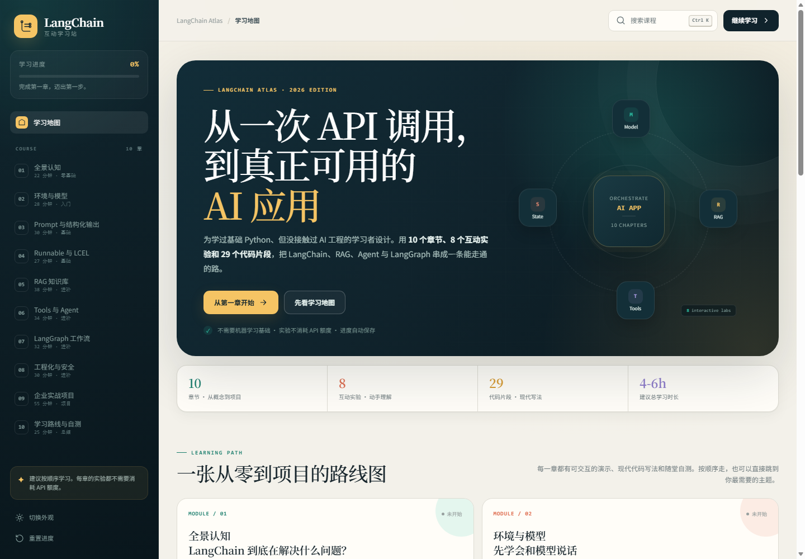

# LangChain Atlas · 交互式教程

一份面向“有基础 Python、但没做过 AI 应用”的学习者的 LangChain 教程网站。

**在线学习：** <https://fenghe1219.github.io/langchain-atlas/>

**GitHub 仓库：** <https://github.com/fenghe1219/langchain-atlas>



## 怎么打开

### 在线访问

直接用浏览器打开 <https://fenghe1219.github.io/langchain-atlas/>，无需安装任何软件，也无需 GitHub 账号。

### 本地打开

如果希望离线学习，可以直接双击 `index.html`。

如果浏览器对本地文件限制较多，也可以在项目目录运行：

```bash
npm start
```

然后访问 <http://localhost:4173>。项目零依赖，不需要 `npm install`。

## 你会学到什么

- LangChain 1.x 风格的心智模型与生态地图
- ChatModel、Messages、PromptTemplate 与结构化输出
- Runnable / LCEL、批处理、流式输出与降级
- RAG：文档切分、Embedding、向量检索、引用回答
- Tools、`create_agent`、Agent 循环与安全边界
- LangGraph：StateGraph、条件分支、Checkpointer、人工审批
- 可观测性、评估、成本、安全与生产检查清单
- 一个企业知识助手项目的架构、代码和验收标准

## 互动功能

- 8 个本地互动实验：应用装配、Prompt 装配、Runnable 流水线、RAG 检索、Agent 轨迹、LangGraph 审批、生产清单、术语卡片
- 29 个代码块，可一键复制
- 10 章随堂自测，即时判分与解析
- 自动保存章节进度与学习笔记到浏览器 `localStorage`
- 全文搜索、深浅色主题、移动端侧边栏

所有实验都在浏览器本地模拟，不调用模型 API，也不消耗额度。

## 目录

```text
.
├─ index.html
├─ assets/
│  ├─ css/                 # 页面、课程、实验样式
│  └─ js/
│     ├─ course-meta.js    # 课程元信息
│     ├─ lesson-01..10.js  # 每章正文、代码与测验
│     ├─ labs.js           # 互动实验
│     └─ app.js            # 路由、进度、搜索、代码高亮
├─ serve.js                # 零依赖本地静态服务器
└─ package.json
```

## 说明

教程按 **LangChain 1.x 风格** 整理，重点讲现代 `init_chat_model`、`ChatPromptTemplate`、Runnable、`create_agent`、LangGraph 与 LangSmith。具体小版本 API 仍可能变化，实际开发时请以官方文档和当前版本迁移指南为准：

- <https://docs.langchain.com/>
- <https://python.langchain.com/>

如果你要改内容，只需要编辑对应的 `assets/js/lesson-XX.js`；每个章节都是独立对象。
